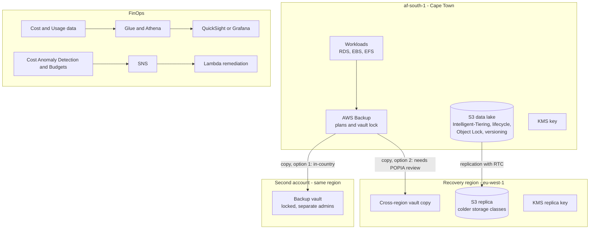
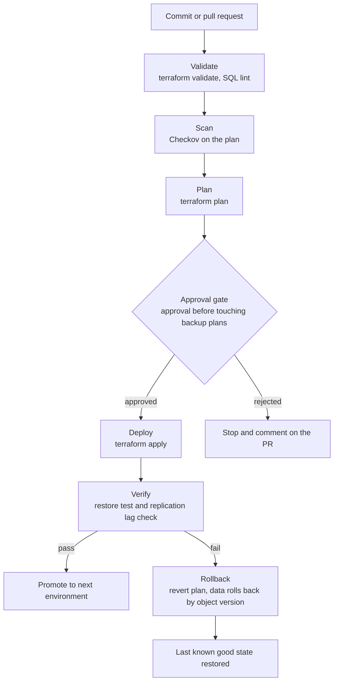
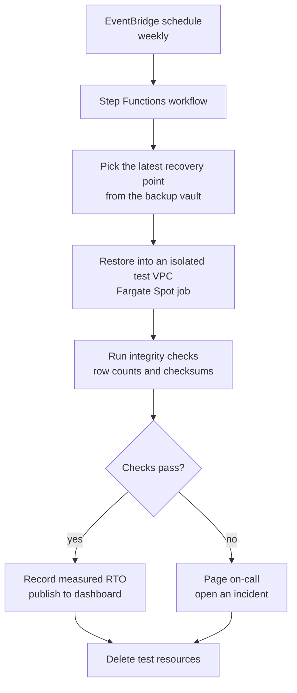

# Resilient Data Estate

A data protection and FinOps platform: tiered S3, vault-locked backups, a restore path that is tested every week, and cost data in Athena that drives automatic cleanup.

### Business use case

A South African healthcare or insurance company holds POPIA-covered data that mostly must stay in South Africa but needs a tested recovery option, and it has a monthly AWS bill nobody can explain. The business pays for provable recovery and for the savings.

### The hard piece

Storage disaster recovery with a measured restore, plus cost optimisation

### Rough monthly cost, ZAR

R300 to R1,000 a month. Storage, Athena and Lambda are cheap, but replication and restore tests add up if you use large datasets, so keep the sample data small.

### Tool stack

- S3 Intelligent-Tiering + lifecycle
- S3 Object Lock (compliance mode)
- S3 versioning + replication with RTC
- S3 Inventory
- AWS Backup (plans, vault lock, restore testing)
- KMS multi-Region keys
- RDS snapshots
- Cost and Usage Report / Data Exports
- Glue + Athena
- QuickSight or Grafana
- Cost Anomaly Detection + Budgets
- Compute Optimizer
- Step Functions
- Lambda + EventBridge Scheduler
- Fargate Spot
- Terraform
- GitHub Actions + OIDC

### Diagrams

#### Diagram 1 · Architecture: two recovery options and the cost loop

> **How to read this:** The same backup can go two places. Option 1 stays in South Africa in a separate account: it survives ransomware and a compromised admin, but not the loss of the region. Option 2 survives a regional failure but is a cross-border transfer you must justify. A mature design shows both and states which one it chose and why. The bottom box is the cost loop.

#### Diagram 2 · CI/CD: infrastructure with a restore test as a gate

> **How to read this:** Follow the top line from a commit to a deploy: the pipeline stops at the first red step, and nothing reaches the approval gate unless validation, scanning and the plan all passed. The bottom branch is the one hiring managers ask about: when verification fails, the rollback box puts the environment back without a human editing the console. The verify step is the interesting one: it restores real data and measures how long it took.

#### Diagram 3 · Hard piece: the weekly restore test

> **How to read this:** A backup you have never restored is a hope, not a backup. This workflow restores into a throwaway VPC every week and writes down how long it took. The number that appears on your dashboard is your real recovery time.

### How it covers the five focus areas

- **Compute** (light): Lambda and Step Functions for remediation and restore testing, Fargate Spot jobs for the restore, instance scheduler for dev, Compute Optimizer rightsizing review.
- **Networking** (light): S3 gateway endpoints, bucket policies restricted by VPC endpoint, no public buckets, private restore VPC with no internet route.
- **Storage · HOME**: Intelligent-Tiering and lifecycle, versioning, Object Lock, replication with RTC, AWS Backup with vault lock and cross-account copy, KMS multi-Region keys, S3 Inventory to find what is actually stored.
- **CI/CD** (deep): Infrastructure pipeline with a restore test as the final gate, policy checks, drift detection.
- **Cost optimisation · HOME**: CUR into Athena, top cost drivers and untagged spend queries, anomaly detection, budgets with actions, Savings Plans coverage review, automatic cleanup with a keep tag.
### Advanced features that show depth

- Step Functions restore test that measures a real RTO every week
- Replication Time Control alarms on lag
- Athena queries for the top ten cost drivers and all untagged spend
- A Lambda that stops or removes untagged resources after a grace period, with a keep tag
- A written decision record on in-country versus cross-region copies and the POPIA reasoning

### Production-like touches

- Separate admin roles for the backup account
- Alerts on replication lag, failed backups and cost anomalies
- Runbook: restore a database to a point in time
- Post-incident write-up: the weekly restore failed once and why
- Savings report posted monthly

### What this proves beyond what you run today

| What you run today | Senior-level version | What it proves |
| --- | --- | --- |
| Daily RDS snapshots | AWS Backup plans with vault lock and restore testing | Backups become tamper-resistant and verified. |
| S3 Standard everywhere | Tiering, lifecycle and Object Lock | You treat storage as a lifecycle, with cost and legal retention in view. |
| Looking at Cost Explorer | CUR in Athena with automated actions | Analysis turns into automation. |
| Single region | Documented recovery options and a measured RTO | You can answer the auditor's question with a number. |

### Résumé pitch

- Designed tiered, Object-Lock-protected storage with cross-account backups and a weekly automated restore test showing a measured RTO of \[N\] minutes.
- Reduced storage and compute spend by \[N\]% using lifecycle policies, Compute Optimizer and Athena-driven cleanup.
- Documented a POPIA-aware recovery design comparing in-country and cross-region options, with a tested decision record.

> *Replace every \[N\] with a number you measured. If you cannot measure it, remove the claim.*
